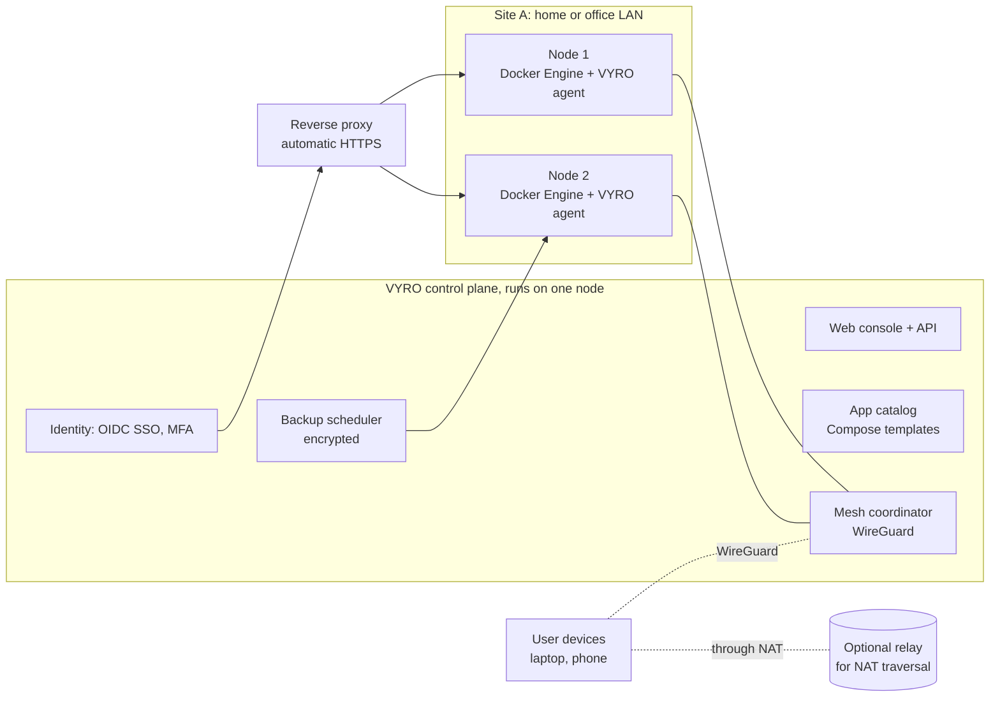

# Discovery report — VYRO PrivateCloud
- Date: 2026-10-21 (preliminary)
- Owner: Head of Product ([SOLON](../../../agent-personas/SOLON.md))
- Contributors: PM, Designer (research), Head of Marketing, CTO, CISO, Business Ops
- Status: **PARTIALLY COMPLETE.** Only the CTO's section is drafted. It was prepared early to help the CEO write the [idea brief](../01-idea/idea-brief.md), and formally becomes Phase 1 input once the CEO approves that brief.

> Phase 1 output (startup workflow, section 3). Every point is labeled **verified** (with a source), **estimate** or **assumption**.

## Problem evidence (Product)
- TBD by SOLON and PERICLES: user interviews that confirm or reject the problem in the idea brief, for the target user the CEO chooses.

## Market and competitors (Marketing)
- TBD by NIKE: market size, positioning options and pricing.
- The CTO's technical scan of comparable platforms is in section T2 below as a starting point. It is a technical view only, not a market analysis.

## Technical feasibility (CTO)

### T1. What "private local cloud network system with Docker" means technically
A set of machines on the user's premises, from one to many, that together provide what a public cloud gives a small user:
1. **Compute:** apps run as Docker containers from a curated catalog, plus custom Compose stacks.
2. **Network:** a private, encrypted network that joins every node and the user's own devices (laptop, phone), at home and away, without opening ports to the internet.
3. **Identity:** one login for every app (single sign-on), with users and roles.
4. **Edge:** automatic HTTPS and friendly names for every app.
5. **Data:** storage plus encrypted, tested backups.
6. **Operations:** one console for install, update, health and restore.

### T2. Technical scan of comparable platforms
Sources are listed at the end of this document.

| Platform | What it is | Notes relevant to VYRO |
|---|---|---|
| Umbrel (umbrelOS, Umbrel Home and Pro hardware) | Home server OS with an app store of hundreds of one-click apps; also sold as hardware | Verified: source code is "fully available" on GitHub, and it ships a built-in MCP server so AI agents can manage it. The licence is not named on the page; check it. Strongest consumer competitor. |
| CasaOS / ZimaOS (IceWhale) | Dashboard and app store on Linux; ZimaOS is the NAS-focused successor | Verified: CasaOS core's last stable release was v0.4.15 (Dec 2024), and development focus has moved to ZimaOS and Zima hardware. |
| Cosmos Cloud | Security-focused self-hosting platform: reverse proxy, OIDC SSO with MFA, built-in VPN, app store, restic backups | Verified: "available source" under the Commons Clause, which restricts selling the software itself. The closest feature match to VYRO, but it is not open source. |
| YunoHost | Self-hosting with more than 400 apps | Verified: avoids containers by design, so apps are not isolated from each other. |
| StartOS | "Sovereign computing" OS | Verified: small app catalog; no 64-bit ARM support (as of Nov 2024). |
| Coolify / Dokploy | Self-hosted PaaS for developers (Docker; Dokploy uses Swarm and Traefik) | Verified: Coolify is Apache-2.0; Dokploy is mostly Apache-2.0 with some proprietary parts. They target app deployment, not households or offices. |

**Technical takeaway [assumption, for Marketing to test]:** single-box home server OSes and developer PaaS tools are both crowded. The less-served space is **multi-machine, multi-site private clouds for small teams**, with a **genuinely open licence** and **secure defaults**: one identity, one private network and tested backups across several nodes.

### T3. Reference architecture (proposed)

**Principles:**
- Local-first: everything works on the LAN with no internet.
- Each node runs plain Docker Engine and Compose, so apps stay portable and users are not locked in.
- The control plane is separate from the per-node agent, so multi-node support is designed in from day one even if the MVP ships single-node.
- Proven open-source components are reused rather than reinvented.

### T4. Architecture options

| Option | Description | Pros | Cons |
|---|---|---|---|
| **A. Single-box appliance OS** | A Linux base image with Docker, a console and a catalog, like Umbrel or ZimaOS | Fastest to build; simplest support | The most crowded segment; hard to stand out; no multi-site story |
| **B. Control plane plus node agents (recommended)** | A thin VYRO control plane plus an agent on each node running Docker; MVP ships one node, multi-node next | Matches "cloud network"; the standout space; grows from home to office | More moving parts; multi-node state and networking are harder |
| **C. Extend an existing platform** | Build on Coolify (Apache-2.0) or similar | Head start | Developer-PaaS DNA does not fit households or offices; Cosmos is not forkable for sale (Commons Clause) |

**CTO recommendation (not a decision):** Option B. Ship single-node first, with the control-plane/agent split in place, and plain Docker Compose as the app format. **Do not adopt Docker Swarm or Kubernetes for the MVP.** Each node runs its own Compose stacks, and the control plane schedules and places them. The CEO approves architecture at the Phase 2 gate (team charter, section 6).

### T5. Build versus reuse (candidates, to verify in Phase 2)

| Capability | Candidate | Licence | Status |
|---|---|---|---|
| Private mesh network | Headscale (Tailscale-compatible control server) | BSD-3-Clause | Verified ([WZ-IT](https://wz-it.com/en/blog/mesh-vpn-comparison-2026-overview/)) |
| Private mesh network, alternative | NetBird | Server AGPLv3; production self-hosting needs a commercial tier | Verified (same source); avoid embedding |
| Reverse proxy and HTTPS | Traefik or Caddy | Permissive (to verify) | Assumption |
| Identity / SSO | Authelia or Authentik | To verify | Assumption |
| Backups | restic | Permissive (to verify) | Assumption; Cosmos already uses it |
| Container runtime | Docker Engine and Compose | Docker Engine is Apache-2.0 (to verify); Docker Desktop is not used | Assumption |

**Rule for the team:** no component with a licence that blocks selling VYRO (Commons Clause, non-commercial terms) goes in the product. AGPL components need a decision from Business Operations, or the CEO while that role is vacant, before we embed them.

### T6. Feasibility verdict
**Feasible** with existing open-source building blocks (estimate, medium confidence). Running Docker is not the hard part. The hard parts are:
1. **Safe updates** of the OS, VYRO and every app, with rollback.
2. **Networking through NAT** (and carrier-grade NAT). Away-from-home access usually needs a relay, which is a small internet dependency that conflicts with "local-only" unless it is optional or self-hostable.
3. **Single sign-on coverage:** many popular self-hosted apps do not support OIDC, so we need a proxy-auth fallback.
4. **Backup and restore of stateful apps** (databases inside containers) that actually restore.
5. **Hardware variety:** x86 versus ARM, disks, GPUs.

### T7. Rough cost (estimates, low confidence)
- **Engineering, single-node MVP** (console, about 10 curated apps, SSO, HTTPS, mesh remote access, backups): **about 4–6 two-week cycles** for a squad of backend, frontend, platform, QA and AppSec. This assumes the designer and frontend roles are activated.
- **Multi-node and multi-site:** **another 4–8 cycles.**
- **Running cost during development:** the CEO's own hardware, plus one small cloud server to test the relay and coordination, **about €5–20/month** (estimate, not a quote). Test devices: one x86 mini PC and one ARM board.
- These are planning ranges, **not commitments** (ATHENA persona, roadmap rules).

### T8. Proposed technical spikes for Phase 1
Each is small and reversible. Code is delivered in chat; nothing runs on the CEO's machines without explicit permission.

| Spike | Question it answers | Owner |
|---|---|---|
| S1 | Can two nodes behind different NATs, plus a phone, join one Headscale-based mesh, and what does the relay cost? | PROMETHEUS |
| S2 | How long does a non-expert take from a blank machine to a first app over HTTPS? | PROMETHEUS, MINOS |
| S3 | Which of the 10 candidate apps support OIDC, and which need proxy-auth? | JANUS, EUNOMIA |
| S4 | Back up and restore a database-backed app end to end | PROMETHEUS, MINOS |

## Legal and security risks (CISO)
- TBD by JUPITER. Inputs from the CTO:
  - A box that holds all of a user's data and is reachable remotely is a **high-value target**.
  - App images are a **supply-chain risk**.
  - The **Docker socket** gives effective root to anything that holds it.
  - **GDPR** questions follow if VYRO ever runs any service (relay, telemetry, updates) that processes user data.

## Business model (Business Ops)
- TBD. Business Operations is vacant, so the CEO decides. Options to compare: open-core software, an appliance, a paid relay or backup service, and business support plans.

## Assumptions list (riskiest first)

| # | Assumption | Why it is risky | How we will test it | Owner |
|---|---|---|---|---|
| 1 | A target user exists who will pay for a private cloud they run themselves | The free alternatives are many | Interviews (Product), competitor and pricing scan (Marketing) | SOLON, NIKE |
| 2 | Multi-machine, multi-site for small teams is less served than single-box home use | It decides Option A versus B | Market scan plus interviews | NIKE, SOLON |
| 3 | Remote access can be made reliable without a mandatory VYRO cloud service | It is core to "local" and to the privacy promise | Spike S1 | PROMETHEUS |
| 4 | Non-experts can install and run it | It is the main promise | Spike S2 plus usability test | PROMETHEUS, Designer |
| 5 | Backups restore reliably | A data-loss incident ends user trust | Spike S4 | PROMETHEUS, MINOS |
| 6 | The open-source components have licences that allow us to sell | It is a legal blocker | Licence review | CEO (Business Ops vacant), JUPITER |

## Sources (CTO technical scan, accessed 2026-10-21)
- [Mesh VPN compared 2026: NetBird, Tailscale, Headscale, ZeroTier, Netmaker and Nebula, WZ-IT (updated 12 Oct 2026; the author is a NetBird reseller)](https://wz-it.com/en/blog/mesh-vpn-comparison-2026-overview/)
- [What is Umbrel, umbrel.com](https://umbrel.com/support/getting-started/what-is-umbrel)
- [Is CasaOS abandoned? Development status, Zima](https://shop.zimaspace.com/pages/is-casaos-abandoned-development-status)
- [Cosmos Cloud, Self Host Yourself](https://selfhostyourself.com/services/cosmos)
- [Best home server OS for self-hosted apps, Make Tech Easier (Nov 2024)](https://maketecheasier.com/best-home-server-os-for-self-hosted-apps)
- [Coolify vs Dokploy, getdeploying.com (Jan 2026)](https://getdeploying.com/guides/coolify-vs-dokploy)
